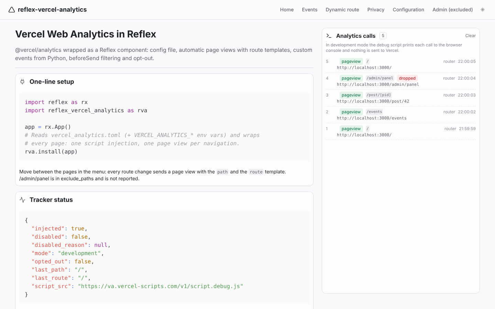
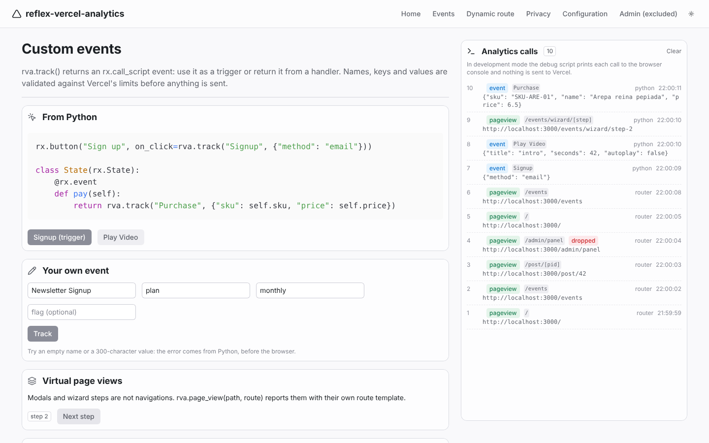
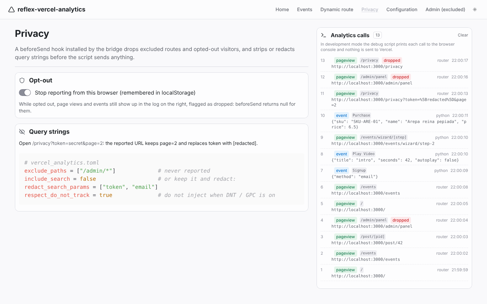
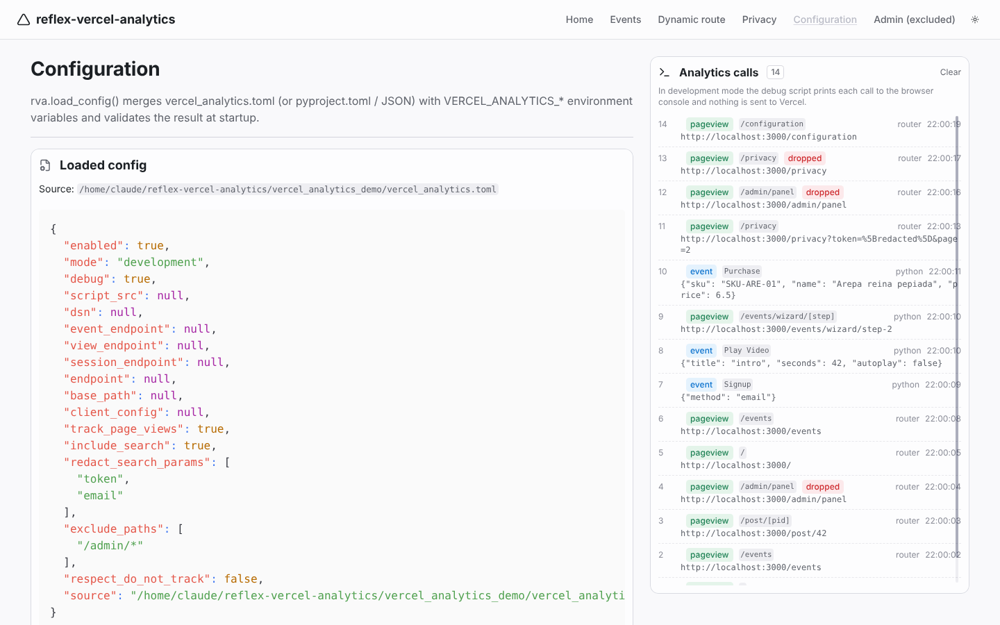

# reflex-vercel-analytics

[Vercel Web Analytics](https://vercel.com/docs/analytics) for [Reflex](https://reflex.dev), powered by [`@vercel/analytics`](https://github.com/vercel/analytics).

- Wraps **@vercel/analytics 2.0.1** (the `Analytics` component from `@vercel/analytics/react`) in a small React bridge, mounted once around the whole app with `rva.install(app)`
- **Config file**: `vercel_analytics.toml` next to `rxconfig.py` (or `[tool.reflex-vercel-analytics]` in `pyproject.toml`, or JSON), validated on load, with `VERCEL_ANALYTICS_*` environment overrides; Vercel's own build variables (`VERCEL_OBSERVABILITY_CLIENT_CONFIG`, `VERCEL_OBSERVABILITY_BASEPATH`) are picked up automatically
- **Automatic SPA page views with route templates**: one page view per React Router navigation, reported as `/post/[pid]` instead of `/post/42`, exactly like the Next.js adapter does, with the script's own pushState tracking disabled so nothing is counted twice; `exclude_paths` for routes you don't want reported
- **Custom events from Python**: `rva.track("Signup", {"method": "email"})` as a trigger or returned from an event handler, with optional feature `flags`; names, keys and values are checked against Vercel's limits (255 characters, flat scalar values) before anything is sent
- **Privacy**: a `beforeSend` hook that strips (`include_search = false`) or redacts (`redact_search_params`) query strings, `opt_out` / `opt_in` remembered in localStorage, optional Do-Not-Track / Global Privacy Control respect
- **Development mode** that loads Vercel's debug script (console only, nothing is sent), resolved automatically from `reflex run` vs `--env prod`, and `on_ready` / `on_page_view` / `on_event` triggers that report what the bridge does to your State

## Why not `@vercel/analytics/next`?

The Next.js entry point reads the route from `next/navigation`. Reflex 0.8+ builds the frontend with Vite and React Router, so that import cannot resolve. This package uses the framework-agnostic `@vercel/analytics/react` adapter and obtains the same information (`path` + route template) from React Router's `useLocation()` / `useParams()`; the SDK label sent to Vercel is `@vercel/analytics/reflex`.

## Screenshots

The demo app ships with `mode = "development"`, so the panel on the right shows each page view and event the bridge issues while the debug script logs them to the browser console.

| | |
| --- | --- |
|  |  |
| Tracker status and the page views recorded so far, `/post/42` reported as `/post/[pid]` | Custom events from a trigger, a handler, a form validated in Python, a virtual page view |
|  |  |
| Opt-out, excluded routes shown as dropped, `?token=secret` redacted | The loaded `vercel_analytics.toml`, the props the bridge receives and the env overrides |

## Installation

```bash
pip install reflex-vercel-analytics
# or
uv add reflex-vercel-analytics
```

The npm package (`@vercel/analytics@2.0.1`) is installed by Reflex automatically the first time the app compiles.

## Quick start

1. Enable Web Analytics for the project in the Vercel dashboard (*Project > Analytics > Enable*).

2. Install the component on the app:

```python
import reflex as rx
import reflex_vercel_analytics as rva

app = rx.App()
rva.install(app)
```

3. Track events:

```python
def index() -> rx.Component:
    return rx.vstack(
        rx.button("Sign up", on_click=rva.track("Signup", {"method": "email"})),
        rx.button("Watch intro", on_click=rva.track("Play Video", {"title": "intro"})),
    )
```

Page views are reported automatically from then on. Under `reflex run` the bridge loads Vercel's **debug script**, which prints every call to the browser console and sends nothing; under `reflex run --env prod` (or an exported frontend) it loads the production script.

That is all you need when the Reflex frontend is deployed on Vercel. For other hosts see [Hosting outside Vercel](#hosting-outside-vercel).

## The config file

A config file is optional: with no file and no environment variables the defaults above apply. `rva.load_config()` (which `install` and `vercel_analytics` call for you) looks for, in order:

1. the file named by `$VERCEL_ANALYTICS_CONFIG` (`.toml` or `.json`);
2. `vercel_analytics.toml` in the directory where `reflex run` starts;
3. `pyproject.toml`, if it has a `[tool.reflex-vercel-analytics]` table.

Then any `VERCEL_ANALYTICS_<FIELD>` environment variable overrides that field. Unknown keys and malformed values raise `rva.ConfigError` at startup, not silently in the browser.

```toml
enabled = true
mode = "auto"                    # "development" under `reflex run`, "production" with --env prod
debug = true                     # console logging in development mode
track_page_views = true          # one page view per navigation, with the route template
include_search = true            # keep "?query" in the reported URL
redact_search_params = ["token", "email"]   # ...but replace these values with [redacted]
exclude_paths = ["/admin/*", "/preview"]    # "/x" exact, "/x/*" prefix
respect_do_not_track = false     # skip injection when DNT / Global Privacy Control is on

# Script and endpoints: only needed outside Vercel or for proxies / multi-app domains.
script_src = ""                  # alternative URL for the analytics script
dsn = ""                         # project DSN when the script is not served by the Vercel deployment
event_endpoint = ""              # where custom events are reported
view_endpoint = ""               # where page views are reported
session_endpoint = ""
base_path = ""                   # "<base_path>/insights/script.js" and "<base_path>/insights"
client_config = ""               # JSON with defaults, the shape of VERCEL_OBSERVABILITY_CLIENT_CONFIG
```

Environment variables: `VERCEL_ANALYTICS_MODE`, `_ENABLED`, `_DEBUG`, `_TRACK_PAGE_VIEWS`, `_INCLUDE_SEARCH`, `_RESPECT_DO_NOT_TRACK` (booleans), `_EXCLUDE_PATHS`, `_REDACT_SEARCH_PARAMS` (comma separated), `_SCRIPT_SRC`, `_DSN`, `_EVENT_ENDPOINT`, `_VIEW_ENDPOINT`, `_SESSION_ENDPOINT`, `_ENDPOINT`, `_BASE_PATH`, `_CLIENT_CONFIG`.

```bash
VERCEL_ANALYTICS_MODE=production reflex run --env prod
VERCEL_ANALYTICS_EXCLUDE_PATHS="/admin/*,/preview" reflex run
```

You can also build the config in code: `rva.install(app, rva.VercelAnalyticsConfig(mode="production"))`, pass a path (`rva.install(app, "config/analytics.toml")`), or skip files entirely with `config=False` and plain props.

### `mode`

`@vercel/analytics` guesses the mode from `NODE_ENV`, which Vite does not expose the same way. This package resolves `auto` on the Python side instead: `development` under `reflex run`, `production` under `reflex run --env prod` and `reflex export`. Force one with `mode = "production"` or `VERCEL_ANALYTICS_MODE`.

## Actions

All helpers return an `rx.call_script` event: use them as triggers, or return/yield them from an event handler. Calls made before the script has loaded are queued by the SDK (`window.vaq`) and sent once it is ready; when tracking is disabled they do nothing.

| Helper | What it does |
| --- | --- |
| `track(name, properties=None, *, flags=None, **properties)` | custom event (`window.va("event", ...)`) |
| `page_view(path=None, route=None)` | manual page view for virtual pages (modals, wizard steps) |
| `opt_out()`, `opt_in()` | stop / resume reporting from this browser (localStorage flag, enforced by `beforeSend`) |
| `get_status(callback)` | send the tracker status dict to a State handler |
| `validate_event_name(name)`, `validate_properties(props)` | the checks `track` runs, to validate user input before sending |

From a handler, with values from the State:

```python
class Shop(rx.State):
    cart: list[dict] = []

    @rx.event
    def pay(self):
        order_id = save_order(self.cart)
        total = sum(i["price"] * i["quantity"] for i in self.cart)
        return rva.track("Purchase", {"order": order_id, "total": total, "items": len(self.cart)})
```

Arguments must be plain Python values; read State vars inside a handler rather than passing `State.var` to a helper. Vercel accepts only strings, numbers, booleans and `null` as property values (no nested objects or lists), and caps event names, keys and values at 255 characters; `track` raises `ValueError` otherwise. Custom events require a Pro or Enterprise plan on Vercel.

### Feature flags

```python
rva.track("Checkout", {"total": 42}, flags=["new-checkout"])
rva.track("Checkout", flags={"new-checkout": True})
```

## Page views and routes

Every client-side navigation sends one page view with the concrete `path` and the **route template**, which is what the Vercel dashboard groups by:

| Reflex route | Browser path | Reported `route` |
| --- | --- | --- |
| `/post/[pid]` | `/post/42` | `/post/[pid]` |
| `/docs/[...slug]` | `/docs/a/b` | `/docs/[...slug]` |
| `/events` | `/events?tab=2` | `/events` |

Virtual pages get their own template through `rva.page_view("/wizard/step-2", route="/wizard/[step]")`.

With `track_page_views = false` the bridge sends nothing itself and the injected script tracks `pushState` on its own (no route templates, no `on_page_view`); `exclude_paths` and the query-string filters still apply through `beforeSend`.

## Privacy

- `exclude_paths`: navigations to these routes are not queued at all, and events fired while on them are dropped by `beforeSend`.
- `include_search = false` removes the query string from every reported URL; `redact_search_params` keeps the query string but replaces the listed values with `[redacted]` (Vercel's [recommendation for sensitive data](https://vercel.com/docs/analytics/redacting-sensitive-data)). The URL fragment (`#...`) is always removed, since OAuth implicit flows and magic links carry tokens there.
- `rva.opt_out()` sets a localStorage flag; from then on `beforeSend` returns `null` for every event until `rva.opt_in()`.
- `respect_do_not_track = true` skips the injection entirely when the browser sends `DNT: 1` or Global Privacy Control.

Vercel Web Analytics does not use cookies and does not store IP addresses, which is why no consent-mode machinery is needed here; see Vercel's [privacy policy for Web Analytics](https://vercel.com/docs/analytics/privacy-policy).

## Component props

`rva.vercel_analytics(...)` / `rva.install(app, ...)` accept every config field as a prop (`mode`, `debug`, `track_page_views`, `include_search`, `redact_search_params`, `exclude_paths`, `respect_do_not_track`, `script_src`, `dsn`, `event_endpoint`, `view_endpoint`, `session_endpoint`, `endpoint`, `base_path`), plus:

| Prop | Description |
| --- | --- |
| `enabled` | master switch; `False` injects nothing and turns every action into a no-op |
| `config_string` | the JSON Vercel passes as `VERCEL_OBSERVABILITY_CLIENT_CONFIG` (`{"analytics": {"scriptSrc": ..., "eventEndpoint": ..., "viewEndpoint": ...}}`) |
| `framework` | SDK label, `reflex` by default |
| `on_ready` | `{injected, disabled, disabled_reason, mode, opted_out, last_path, last_route, script_src}` once after mounting |
| `on_page_view` | `{path, route, url, dropped}` after each automatic page view |
| `on_event` | `{source, type, name, data, path, route, url, dropped, timestamp}` for every page view and event the bridge issues (debugging only: one backend round trip per call) |

Mount it once. `install` puts it in `app.extra_app_wraps`, so it lives above the pages and is not re-created on navigation; you can also place `rva.vercel_analytics()` in a shared layout yourself.

## Deploying on Vercel

A Reflex app has two halves: the frontend (`reflex export --frontend-only`, a static Vite build) and the backend (Python). Web Analytics only concerns the frontend:

1. Deploy the exported frontend as a Vercel project and enable Web Analytics for it. Vercel serves `/_vercel/insights/script.js` and the collection endpoints on that domain, which is what the SDK uses by default.
2. Build with `mode = "production"` (or `reflex export`, where `auto` resolves to production).
3. If Vercel provides `VERCEL_OBSERVABILITY_CLIENT_CONFIG` / `VERCEL_OBSERVABILITY_BASEPATH` at build time (Resilient Intake), `load_config()` forwards them to the component automatically, so the script and endpoints match what a Next.js project would use.

## Hosting outside Vercel

The default script URL (`/_vercel/insights/script.js`) and endpoints only exist on a Vercel deployment. On another host (Reflex Cloud, your own server) point the SDK at a Vercel project explicitly:

```toml
mode = "production"
script_src = "https://<your-project>.vercel.app/_vercel/insights/script.js"
view_endpoint = "https://<your-project>.vercel.app/_vercel/insights/view"
event_endpoint = "https://<your-project>.vercel.app/_vercel/insights/event"
dsn = "<project DSN>"
```

Whether a given setup is accepted by Vercel is up to Vercel; `script_src`, the endpoints and `dsn` are the knobs `@vercel/analytics` exposes for it, and the `development` mode lets you verify the integration locally regardless of hosting.

## How it works

```
vercel_analytics.toml ─┐
VERCEL_ANALYTICS_* env ┼─> load_config() -> VercelAnalyticsConfig -> props (mode resolved)
VERCEL_OBSERVABILITY_* ┘                                              │
rva.install(app) ── extra_app_wraps ──> <ReflexVercelAnalytics> (vercel_analytics.jsx)
                                          ├─ <Analytics beforeSend=... route={null}>  (@vercel/analytics/react)
                                          │    └─ injects the script once (disableAutoTrack)
                                          ├─ useLocation() + useParams() -> pageview({route, path}) per navigation
                                          ├─ beforeSend: exclude_paths, include_search, redact_search_params, opt-out
                                          └─ window.__reflexVA  <── rva.track(...), rva.page_view(...) (rx.call_script)
```

## Demo app

```bash
git clone https://github.com/ecrespo/reflex-vercel-analytics
cd reflex-vercel-analytics
uv sync
uv pip install -e .
cd vercel_analytics_demo
uv run reflex run
```

Six pages (home, events, `/post/[pid]`, privacy, configuration, and `/admin/panel`, which is excluded) with a live log of every page view and custom event. Open the browser console to see what the debug script receives. To send real data from a Vercel deployment:

```bash
VERCEL_ANALYTICS_MODE=production uv run reflex export --frontend-only
```

## Development

```bash
uv sync
uv pip install -e .
uv run pre-commit install --install-hooks   # ruff, uv.lock and file checks on commit; pytest on push
uv run pytest
uv run ruff check .
uv run --python 3.13 python scripts/generate_pyi.py       # regenerate vercel_analytics.pyi after changing props
uv build                                    # sdist + wheel in dist/
```

### Continuous integration

`.github/workflows/ci.yml` runs on every push and pull request:

| Job | Checks |
| --- | --- |
| `pre-commit` | `uv.lock` is current, file hygiene, ruff lint + format |
| `pytest` | the test suite on Python 3.10, 3.11, 3.12 and 3.13 |
| `build + smoke test` | `uv build`, `twine check --strict`, the wheel ships the JSX bridge and stubs, then the wheel and the sdist are each installed in a clean environment and exercised by `scripts/smoke_test.py` |
| `vercel_analytics.pyi is current` | regenerating the stub produces no diff |
| `demo app compiles` | `reflex compile` of the demo, with the bridge and `@vercel/analytics@2.0.1` in the compiled frontend |

Run the same gate locally (nothing is uploaded) with `scripts/prepublish.sh` or `scripts/prepublish.sh vX.Y.Z`.

### Releasing

`.github/workflows/publish.yml` publishes to PyPI through [Trusted Publishing](https://docs.pypi.org/trusted-publishers/), so no API token is stored. The pre-publication is a **pre-release on PyPI** (`X.Y.ZrcN`): pip and uv skip pre-releases unless they are pinned, so users never get it by accident.

| Trigger | Result |
| --- | --- |
| *Actions > Publish > Run workflow* | dry run: CI, release checks, build, smoke tests; nothing is uploaded |
| GitHub **pre-release**, tag `vX.Y.ZrcN` | `X.Y.ZrcN` on PyPI, after approval, then verified |
| GitHub release, tag `vX.Y.Z` | `X.Y.Z` on PyPI, after approval, then verified |

Each upload waits for approval on the `pypi` environment and is then installed from PyPI in a clean environment and smoke-tested. `scripts/check_release.py` stops the run before building if the tag isn't `v<version>`, if the pre-release flag doesn't match the version (`rcN`/`bN`/`aN` must be pre-releases, final versions must not), if a final version has no `## X.Y.Z` entry in `CHANGELOG.md`, or if the version already exists on PyPI.

One-time setup:

1. On [pypi.org/manage/account/publishing](https://pypi.org/manage/account/publishing/), *Add a new pending publisher* > GitHub: project `reflex-vercel-analytics`, owner `ecrespo`, repository `reflex-vercel-analytics`, workflow `publish.yml`, environment `pypi`.
2. In *GitHub > Settings > Environments*, create `pypi` and add yourself as a required reviewer.

Release procedure:

1. Set the version (`uv version 0.2.0rc1`), add the `CHANGELOG.md` entry and run `scripts/prepublish.sh v0.2.0rc1`.
2. Push to `main` and create a GitHub release tagged `v0.2.0rc1` with **Set as a pre-release** ticked; approve the `pypi` deployment. Try it in a real app with `pip install reflex-vercel-analytics==0.2.0rc1`.
3. When the candidate is good, `uv version 0.2.0`, push, and create a normal release tagged `v0.2.0`.

## Notes

- Never send personally identifiable information (emails, names, phone numbers) as event properties; it violates Vercel's terms.
- Ad blockers commonly block `va.vercel-scripts.com` and `/_vercel/insights`; the SDK logs a one-line message to the console when the script fails to load and the queue simply never drains.
- `endpoint` is deprecated in `@vercel/analytics` 2.x in favour of `event_endpoint` / `view_endpoint`; it is still forwarded for older setups.

## License

MIT
